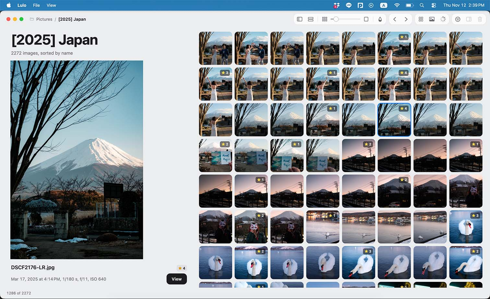
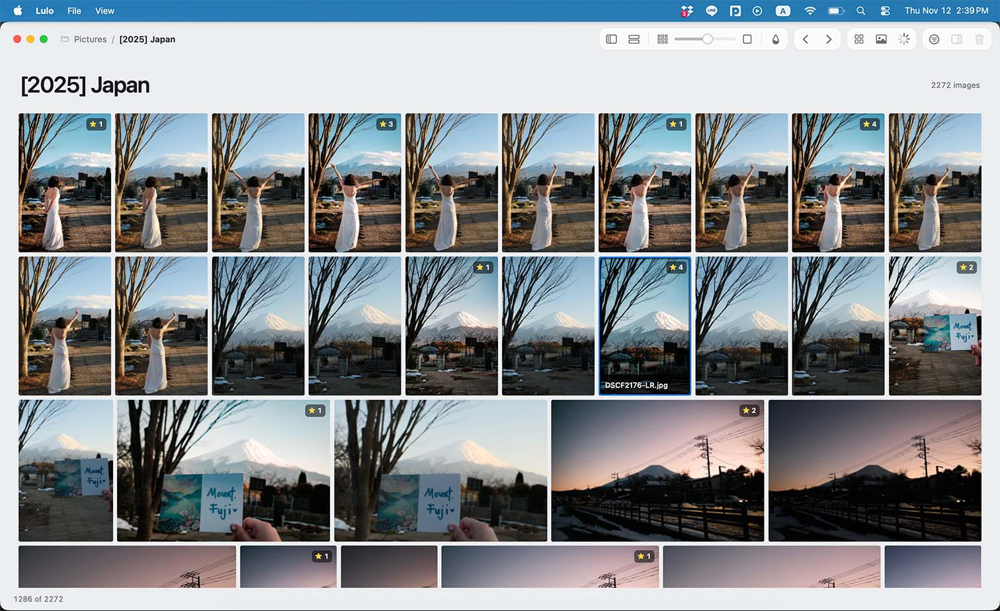
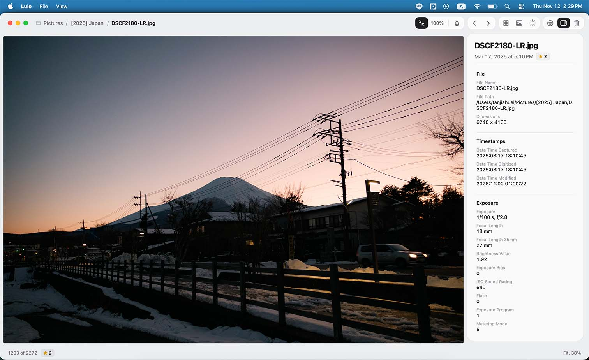
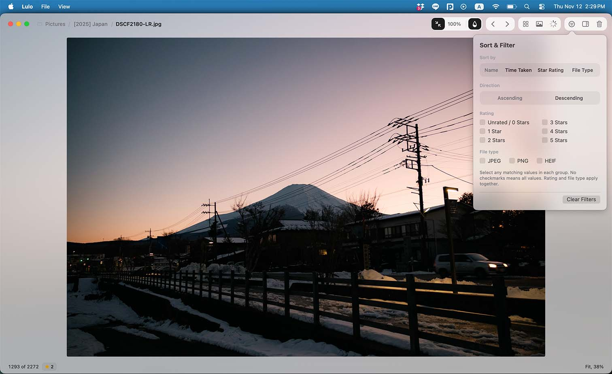

# Lulo

I built this image viewer because I looked around and I couldn't find any image viewer that does what I want: a simple, no-nonsense image viewer where I can easily inspect, sort, filter, and delete images, all while having a great looking UI.

Built with native macOS controls, Lulo keeps your images front and center. No editing, catalogs, accounts, or cloud services.

- **Open JPEG/JPG, PNG, HEIF/HEIC, BMP, JPEG XL, and WebP images**.
- **Browse with the arrow keys** after granting access to the containing folder.
- **See the folder at a glance** with Gallery (Command-G). Double-click a thumbnail or press Return to view the selected image.
- **Fit, zoom, and pan** with fit-to-window and 100% views, scroll zoom, and drag panning.
- **Stay up to date** as images change or files are added or deleted. Refresh either view manually with Command-R.
- **See embedded star ratings** in both Gallery and the image view.
- **Inspect embedded metadata**, including camera settings, capture dates, and location when available.
- **Sort** by name, capture time, star rating, or file type, and **filter** by rating and file type.
- **Move unwanted images to Trash** with a confirmation and Command-Delete.
- **Keep your sorting preferences** between launches. Viewing starts in Fit to Window; navigation preserves the selected fit/100% mode and relative viewing position.

Requires **macOS 14 or later**. Supports Apple Silicon and Intel Macs. RAW images are not supported.

## Take a look

### Gallery with preview

### Gallery rows

### Image metadata

### Sort and filter

## Try Lulo

Development previews are available through the **Lulo test build** download comment on pull requests. See the [download and first-launch instructions](QUICKSTART.md#download-a-pr-test-build); no Xcode is needed.

Open an image from Finder or **File > Open**. Allow access to its folder to browse neighboring images, or cancel to view just that image.

For building, testing, and contributing, see the [development guide](QUICKSTART.md).

For a fresh MacBook setup through Mac App Store publication, follow the [App Store checklist](APP_STORE_CHECKLIST.md).

The D9 interface adds a folder breadcrumb, capsule controls, Rows and Preview gallery layouts with saved sizes, a floating metadata panel, numbered ratings and an optional image-derived blurred background.
